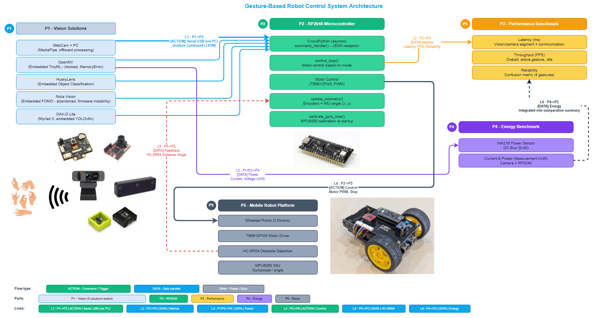
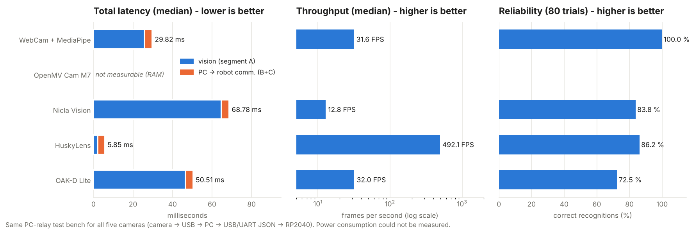
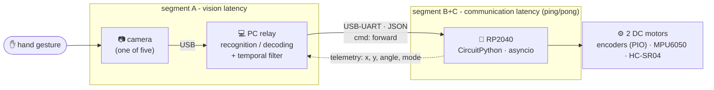
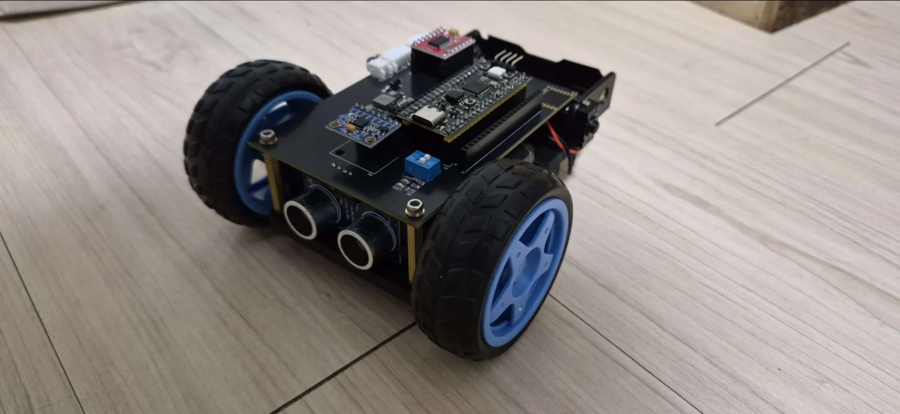
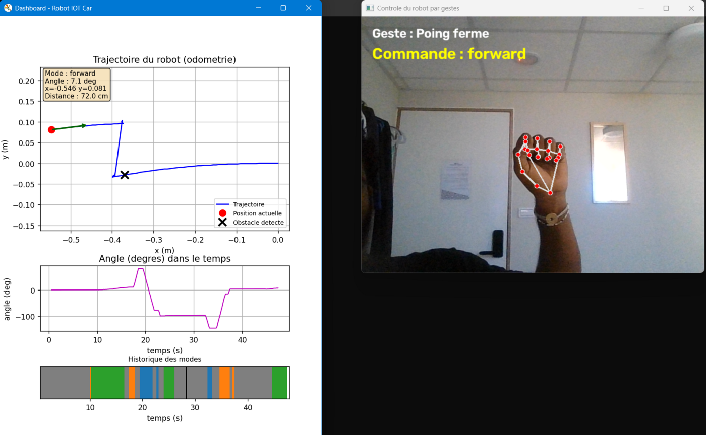
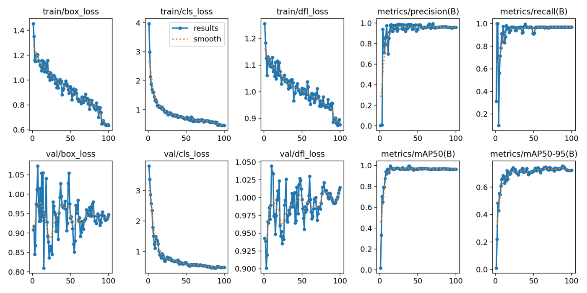
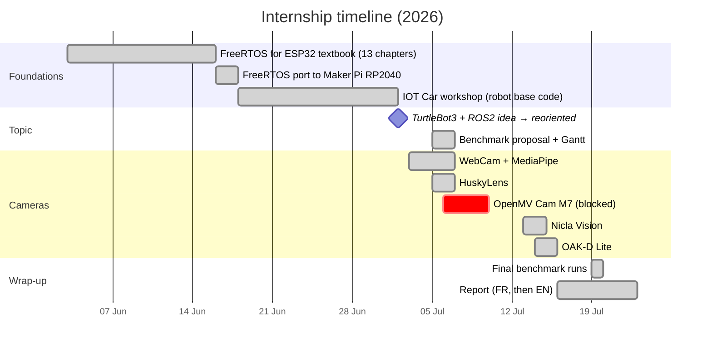
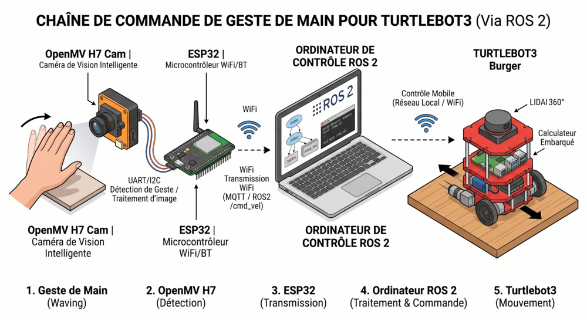
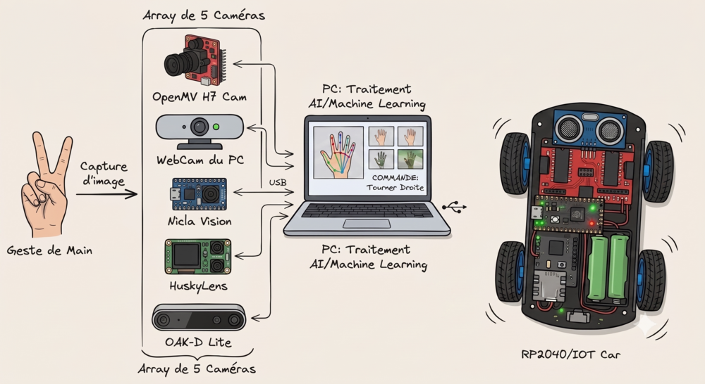

<div align="center">

# 🤖✋ Gesture-Controlled IOT Car - Benchmark of 5 Embedded Vision Solutions

**Which camera should drive a small robot with hand gestures?**
Five vision solutions, one robot, one test bench, the same four metrics.




</div>

> [!NOTE]
> R&D internship carried out from May to July 2026 as an **academic project abroad** (Taiwan),
> as part of an international mobility programme (Embedded Systems).
> The work was done in French - code comments, console messages and the original report are in French; this README and the
> [benchmark report (PDF)](docs/benchmark-report.pdf) are in English.

---

## ⚡ The answer in 10 seconds

| | Latency (median) | Throughput (median) | Reliability (80 trials) | Embedded? | Verdict |
|---|:---:|:---:|:---:|:---:|---|
| **WebCam + MediaPipe** | 🥈 29.8 ms | 🥉 31.6 FPS | 🥇 **100 %** | ❌ PC does everything | the safe choice |
| **HuskyLens** (K210) | 🥇 **5.9 ms** | 🥇 **492 FPS** | 🥈 86.2 % | ✅ | the fastest |
| **Nicla Vision** (STM32H7) | 68.8 ms | 12.8 FPS | 🥉 83.8 % | ✅ | slow, unstable firmware |
| **OAK-D Lite** (Myriad X) | 🥉 50.5 ms | 🥈 32.0 FPS | 72.5 % | ✅ | strongest model, weakest in practice |
| **OpenMV Cam M7** (STM32F7) | - | - | - | ✅ | ❌ model does not fit in RAM |

<p align="center"></p>

**There is no universal winner** - pick by what matters for the application:

| If you care most about… | Choose | Why |
|---|---|---|
| ⚡ pure responsiveness | **HuskyLens** | 5.85 ms end-to-end; the K210 NPU runs a tiny classifier |
| 🎯 recognition reliability | **WebCam + MediaPipe** | 80/80 - geometric rules on hand landmarks, no training |
| 🔋 independence from a PC | **HuskyLens** | training is done *on the device* with its button |
| 🛠️ fastest to implement | **WebCam + MediaPipe** | no extra hardware, no dataset, no training |
| 🚀 room for harder vision tasks | **OAK-D Lite** | the only one able to run modern detectors (YOLOv8n at ~32 FPS) |

---

## 🔧 How it works



**Why a PC relay for every camera?** Some of them (HuskyLens, OpenMV, Nicla) could talk to the robot directly.
Forcing all five through the *same* `camera → USB → PC → USB/UART → RP2040` chain keeps the communication segment a **controlled variable**,
so the comparison only measures the vision part.

| Gesture | Command | JSON sent to the robot |
|---|---|---|
| ✊ closed fist | forward | `{"cmd": "forward"}` |
| ✋ open hand | stop | `{"cmd": "stop"}` |
| 👆 index + thumb | turn left | `{"cmd": "turn_left"}` |
| 🤘 index + pinky | turn right | `{"cmd": "turn_right"}` |

<p align="center"></p>

On the robot, [`code.py`](robot/code.py) runs two `asyncio` tasks: a command handler reading JSON lines from `stdin`, and a control loop
(gyro-bias calibration, heading integration, wheel odometry, HC-SR04 obstacle stop, and a **0.4 s safety timeout** that stops the car if no command arrives).

---

## 📏 What was measured, and how

| Metric | Protocol | Script (per camera) |
|---|---|---|
| **Latency** | Segment A = image → recognised gesture on the PC; segment B+C = JSON `{"ping": n}` round trip PC ↔ RP2040. 100 samples each, median reported. | `benchmark/latency/benchmark_latence_*.py` |
| **Throughput** | Inference results per second over a fixed window (warm-up excluded), split by "detection / no detection". | `benchmark/fps/benchmark_fps_*.py` |
| **Reliability** | 80 manual trials (20 per gesture): the operator presses the key of the gesture he *intended*; the script logs what the model *saw* → confusion matrix. | `benchmark/reliability/benchmark_fiabilite_*.py` |
| **Power** | INA219 in series with each camera. | ⚠️ not done - see below |

Every run exports **CSV + XLSX** (raw samples + summary) and a Matplotlib chart, all committed next to the scripts.

> [!WARNING]
> **Power consumption was not measured for any camera.** Inserting the INA219 meant cutting a power wire on hardware lent by the laboratory,
> which was not done without explicit permission. The limitation applies equally to all five solutions, so it introduces no bias between them.

---

## 🧪 The five contenders

<details>
<summary><b>1 · WebCam + MediaPipe</b> - 🥇 reliability · no training at all</summary>

<br>

| | |
|---|---|
| **Hardware** | MSI Thin A15 built-in webcam - all the processing runs on the PC |
| **Recognition** | MediaPipe Hands → 21 landmarks → count raised fingers (T-I-M-R-P) → gesture |
| **Code** | [`cameras/1-webcam-mediapipe/`](cameras/1-webcam-mediapipe) - `testing/` → `serial/` → `serial-dashboard/` → `serial-dashboard-upgrade/` → `benchmark/` |
| **Result** | 25.90 ms vision + 3.92 ms comm. = **29.82 ms** · **31.62 FPS** (camera-bound) · **80/80** |

The real-time **dashboard** (Matplotlib) plots the robot trajectory from odometry, its heading, and a colour-coded timeline of the commands, and exports each session to CSV/XLSX.



</details>

<details>
<summary><b>2 · OpenMV Cam M7</b> - ❌ blocked by hardware</summary>

<br>

| | |
|---|---|
| **Hardware** | STM32F765 Cortex-M7 @ 216 MHz, 512 KB RAM, OV7725 sensor, no NPU |
| **Pipeline** | Dataset captured with the camera in OpenMV IDE (282 images, 4 classes, 82/18 split) → Edge Impulse image classification → firmware with the model built in (later object-detection attempts are kept too) |
| **Code** | [`cameras/2-openmv-cam-m7/`](cameras/2-openmv-cam-m7) |
| **Result** | `Failed to allocate tensors` (64×64), then a systematic `MemoryError … allocating 4080 bytes` (48×48 and below) |

> [!CAUTION]
> Six fixes were tried one after another: resolution down to 32×32 with a tiny custom CNN, the EON Compiler (estimated RAM 22.7 KB),
> fixing a capture-window / QQVGA mismatch, loading the model before the camera, loading it with no camera at all (47.7 KB free),
> and a full firmware update (after recovering the board through its BOOT0 jumper). The same 4080-byte allocation failed every time.
> Conclusion: a hardware limit of this old board (no NPU, no external RAM) - on paper it can do TinyML, in practice this variant cannot.

</details>

<details>
<summary><b>3 · Arduino Nicla Vision</b> - FOMO object detection · 83.8 %</summary>

<br>

| | |
|---|---|
| **Hardware** | STM32H747 dual core (M7 480 MHz + M4 240 MHz), 1 MB RAM, no NPU |
| **Pipeline** | 160 images (40/class, 80/20 split) → Edge Impulse **FOMO** object detection (MobileNetV2 0.35, 96×96) → OpenMV firmware with embedded model → `main.py` on the camera prints detections → `nicla_to_serial.py` relays them |
| **Code** | [`cameras/3-nicla-vision/`](cameras/3-nicla-vision) - incl. a discarded image-classification attempt (`version-1/flop-version`) and an Arduino C++ attempt (`arduino-control/`) |
| **Result** | 64.76 + 4.02 = **68.78 ms** · **12.82 FPS** · **67/80** |

> [!WARNING]
> The `NMS` post-processing of the OpenMV firmware (`ml/utils.py`) crashes after tens of seconds to a few minutes of inference,
> sending the camera back to its prompt - the OpenMV v5 firmware had changed the `ml` API the Edge Impulse scripts relied on.
> The benchmark scripts therefore stop on a safety time limit (90 s) and export what they collected.
> Lesson from an earlier attempt: horizontal-flip data augmentation *hurts* here, since it turns a "left" gesture into a "right" one.

</details>

<details>
<summary><b>4 · HuskyLens</b> - 🥇 latency · trained with a button</summary>

<br>

| | |
|---|---|
| **Hardware** | Kendryte K210 (dual-core RISC-V 400 MHz + ~1 TOPS NPU), built-in screen |
| **Pipeline** | *Object Classification* mode, trained on the device (button) - 4 gesture IDs + a neutral ID 5 to absorb false positives → `huskylib.py` over USB (CP2102N) → `huskylens_to_serial.py` |
| **Code** | [`cameras/4-huskylens/`](cameras/4-huskylens) - incl. the device configuration backup (`config-backup/*.conf`) |
| **Result** | 2.01 + 3.84 = **5.85 ms** · **492 FPS** · **69/80** |

> [!TIP]
> The 492 FPS is the rate at which the PC can *read* results, not the camera's frame rate: the K210 keeps answering with its last classification.
> It is still the most responsive chain - but the 5-frame confirmation filter used when driving adds its own delay on top.
> Most errors fall into **Stop**, which acts as the model's "default" class.

</details>

<details>
<summary><b>5 · OAK-D Lite (Luxonis)</b> - mAP50 96.6 % in training, 72.5 % in real use</summary>

<br>

| | |
|---|---|
| **Hardware** | Intel Movidius **Myriad X** VPU (4 TOPS), stereo + RGB sensors |
| **Pipeline** | `capture_dataset.py` (160 images) → labelling on Edge Impulse (79/21 split) → **YOLOv8n** training (Ultralytics) → ONNX → `.blob` (OpenVINO 2022.1, 6 shaves) → DepthAI pipeline → `oakd_to_serial.py` |
| **Code** | [`cameras/5-oak-d-lite/`](cameras/5-oak-d-lite) - dataset, YOLO training run (`runs/`, `best.pt`, `best.onnx`, `best.blob`) |
| **Result** | 46.60 + 3.91 = **50.51 ms** · **31.98 FPS** · **58/80** |



> [!IMPORTANT]
> The confusion matrix shows **no confusion between gestures** - every error is a *missed* detection (Stop 45 %, Right 60 %).
> The reliability script uses a fixed 0.5 confidence threshold and no temporal filter, so it is sensitive to the exact instant of the key press.
> The gap with the training mAP says as much about the **test protocol** as about the model.

</details>

---

## 🗓️ How the project unfolded



The internship started on a much more ambitious idea - **gesture control of a TurtleBot3 under ROS 2** with an OpenMV camera and an ESP32 bridge.
After discussion with my supervisor it was narrowed to a question that could be answered rigorously in the time available:
*comparing camera solutions on the same robot.* It began with three cameras and grew to five.

| First idea (ROS 2 / TurtleBot3) | Final topic (5-camera benchmark) |
|:---:|:---:|
|  |  |

The FreeRTOS groundwork is in a separate repository: **[freertos-esp32-arduino](https://github.com/SivaharanKS/freertos-esp32-arduino)**.

---

## 💡 Lessons learned

- **Datasheets don't predict the ranking.** The most powerful chip (OAK-D Lite, 4 TOPS) was the least reliable; the simplest one (HuskyLens) was the fastest.
- **Training metrics ≠ field metrics.** A 96.6 % mAP50 became 72.5 % in front of a real user with a fixed threshold and no temporal filter.
- **Memory, not MHz, decides TinyML.** The OpenMV M7 fails on its 512 KB of RAM, not on its CPU.
- **Toolchains move fast.** One OpenMV firmware update (v5) was enough to break the Edge Impulse examples on the Nicla Vision.
- **Data augmentation can hurt.** Horizontal flips turn a "left" gesture into a "right" one.
- **Control what you don't compare.** Routing every camera through the same PC relay is what makes the latency numbers comparable.

---

## 🗂️ Repository map

```
iot-car-gesture-vision-benchmark/
├── robot/                       CircuitPython code of the IOT Car (RP2040)
├── cameras/
│   ├── 1-webcam-mediapipe/      testing → serial → dashboard → dashboard-upgrade → benchmark
│   ├── 2-openmv-cam-m7/         3 datasets, 2 Edge Impulse trainings, FOMO attempt
│   ├── 3-nicla-vision/          test version, version 1 (+ discarded variant), Arduino attempt, benchmark
│   ├── 4-huskylens/             training, PC relay, device config backup, benchmark
│   └── 5-oak-d-lite/            dataset, YOLOv8n training + export, PC relay, benchmark
└── docs/
    ├── benchmark-report.pdf     ← the benchmark, written up (≈90 pages)
    ├── benchmark-report-src/    LaTeX source of that PDF
    ├── design/                  draw.io architecture, block diagram, Gantt
    └── assets/                  images used by this README
```

Each `benchmark/` folder contains the scripts **and** their raw outputs (`.csv`, `.xlsx`, `.png`) - including earlier runs, kept for traceability.

## ▶️ Reproducing

| Part | Requirements |
|---|---|
| Robot | Maker Pi RP2040 + IOT Car chassis, CircuitPython, libraries `adafruit_hcsr04`, `adafruit_mpu6050`; copy `robot/*.py` to `CIRCUITPY` |
| WebCam | Python 3.11, `opencv-python`, `mediapipe`, `pyserial`, `matplotlib`, `pandas`, `openpyxl` |
| HuskyLens | `pyserial`, CP2102N driver; flash the gestures with the device button or restore `config-backup/` |
| OpenMV / Nicla | OpenMV IDE; flash the Edge Impulse firmware (`*.bin`) then run `main.py` / `ei_object_detection.py` |
| OAK-D Lite | `depthai` (v3), `ultralytics`; `best.blob` must sit next to the scripts |

Serial ports are hard-coded (`COM…`) at the top of each script - change them to yours.

## 🙏 Credits

- The host laboratory, for the hardware and the guidance.
- The IOT Car base modules **`robot.py`, `pid_controller.py`, `pio_encoder.py` were provided by the host lab** during the workshop; `code.py` and everything under `cameras/` are my work.
- `huskylib.py` is DFRobot's HuskyLens Python library; the Edge Impulse firmwares and `ei_*.py` scripts are generated by Edge Impulse; `yolov8n.pt` comes from Ultralytics.
